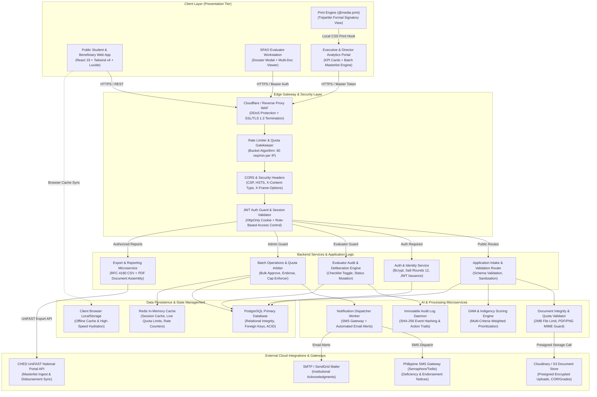
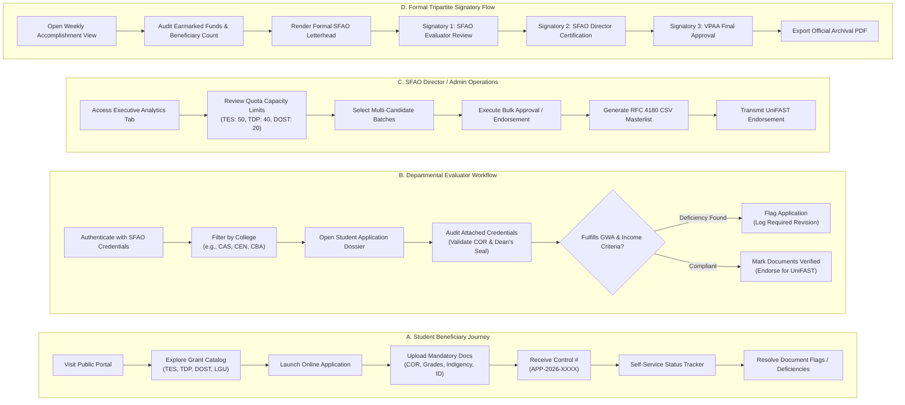
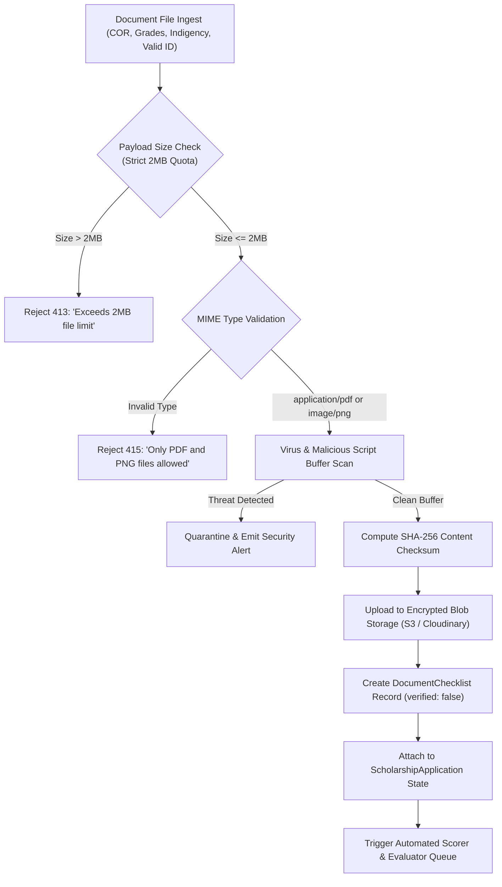
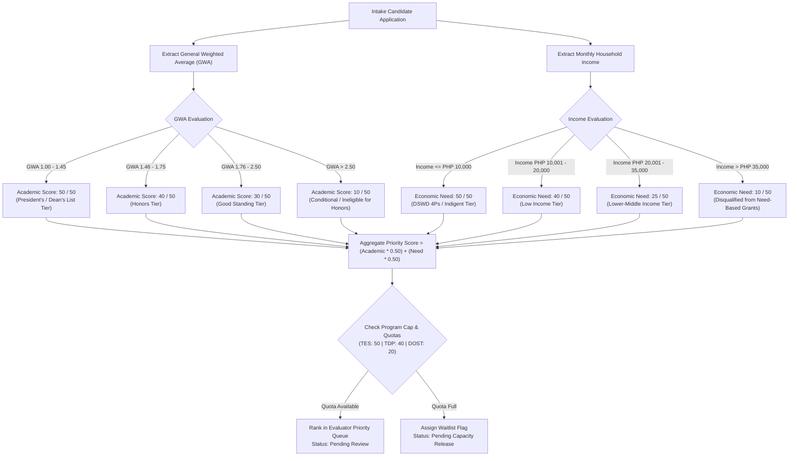
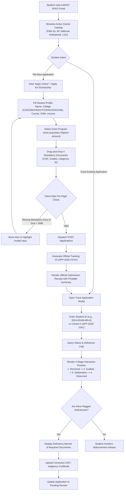
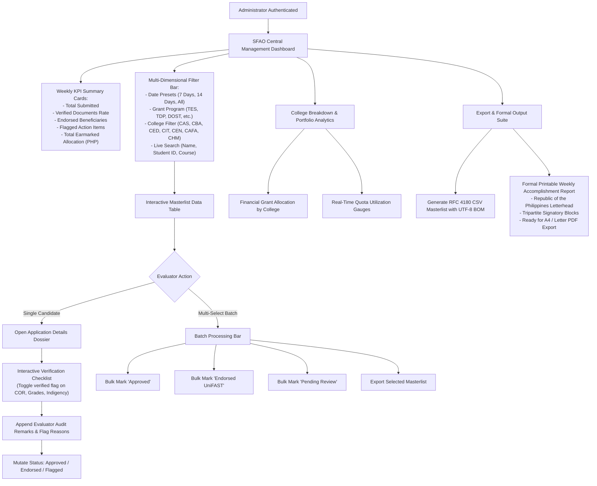
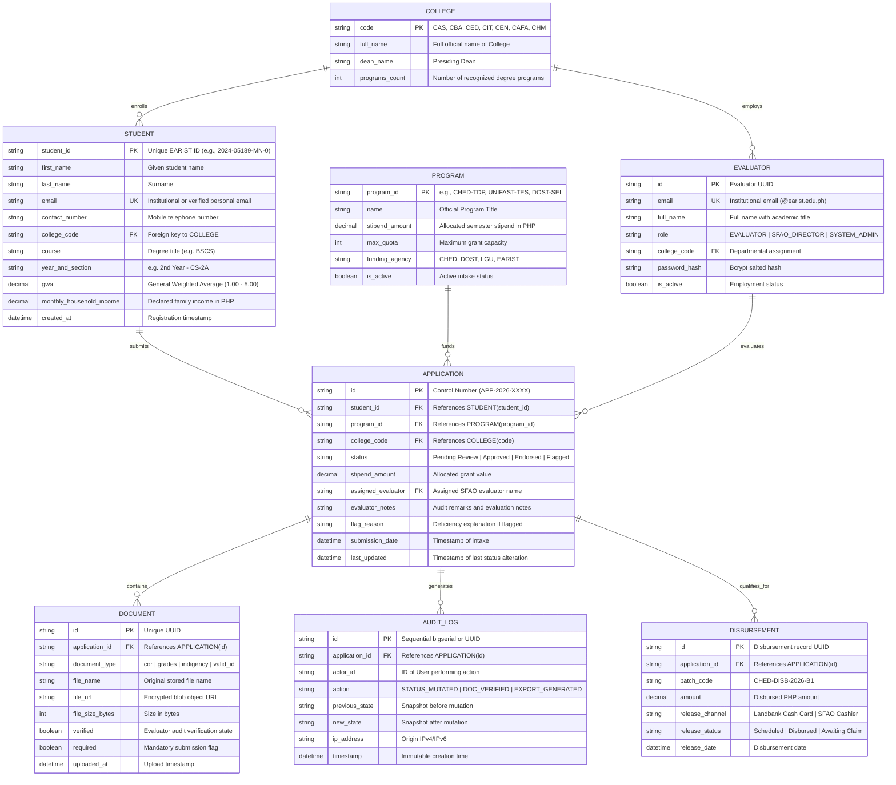
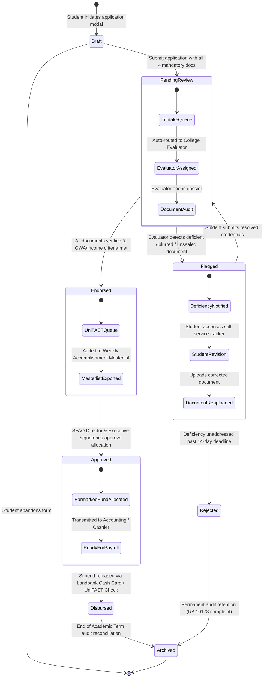
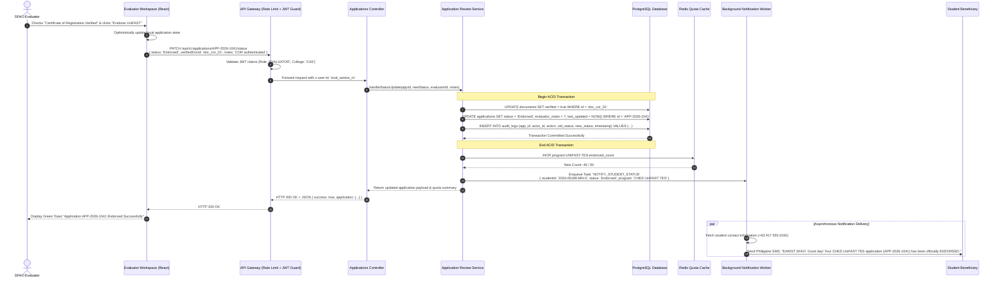

# EARIST e-Scholarship Management System (SFAO) — Visual System Flow & Architecture
**Document Version:** 2.4.0-PROD  
**Classification:** Institutional Capstone / Enterprise Technical Architecture  
**Author:** Senior Principal Software Architect & Technical Lead  
**Target Institution:** Eulogio "Amang" Rodriguez Institute of Science and Technology (EARIST)  
**Governing Body:** Office of Student Financial Assistance (SFAO) & CHED UniFAST Board  
**Target Standard:** ISO/IEC 25010 Quality Model & RA 10173 (Data Privacy Act of 2012)

---

## 1. High-Level Architecture

The system implements a decoupled modern web architecture separating the high-traffic public student portal from the authenticated, high-security SFAO evaluator workstation, administrative analytics core, background audit workers, and external regulatory reporting bridges.



---

## 2. Authentication & Authorization Flow

The system employs a zero-trust, role-segregated authentication architecture. Evaluators and administrators authenticate using cryptographically salted credentials, receiving an ephemeral JSON Web Token (`JWT`) packaged inside an `HttpOnly`, `SameSite=Strict`, `Secure` cookie to mitigate Cross-Site Scripting (XSS) and Cross-Site Request Forgery (CSRF).

```mermaid
sequenceDiagram
    autonumber
    actor User as SFAO Evaluator / Admin
    participant Browser as Client Browser (React)
    participant Gateway as API Gateway / Auth Guard
    participant AuthService as Auth Microservice
    participant Database as PostgreSQL (Users Table)
    participant AuditLog as Audit Daemon

    Note over User,Browser: 1. Evaluator Login Initiation
    User->>Browser: Enters institutional email (@earist.edu.ph) & Password
    Browser->>Gateway: POST /api/v1/auth/login (TLS 1.3)
    Gateway->>Gateway: Enforce IP Rate Limiting (5 attempts / 15 mins)

    Note over Gateway,AuthService: 2. Credential Verification & Hash Comparison
    Gateway->>AuthService: Delegate credentials payload
    AuthService->>Database: SELECT id, password_hash, role, college, is_active FROM users WHERE email = ?
    Database-->>AuthService: Return User Record
    AuthService->>AuthService: bcrypt.compare(inputPassword, storedHash, saltRounds=12)

    alt Password Invalid or Account Inactive
        AuthService->>AuditLog: Log Failed Auth Attempt (IP, Email, Timestamp)
        AuthService-->>Gateway: 401 Unauthorized ("Invalid credentials")
        Gateway-->>Browser: 401 Unauthorized Response
        Browser-->>User: Display error banner & lockout counter
    else Password Valid
        AuthService->>AuthService: Sign JWT Payload {userId, role, college, exp: 8h, iss: 'earist-sfao'}
        AuthService->>AuditLog: Record Successful Login (User ID, College, Role)
        AuthService-->>Gateway: Set-Cookie: token=JWT; HttpOnly; Secure; SameSite=Strict; Path=/
        Gateway-->>Browser: 200 OK + { user: { name, role, college, permissions } }
        Browser->>Browser: Store user state in memory; Redirect to /scholarships#evaluator
        Browser-->>User: Render Evaluator Masterlist Workspace
    end

    Note over User,Browser: 3. Subsequent Protected API Invocation
    User->>Browser: Clicks "Batch Approve Candidates"
    Browser->>Gateway: PATCH /api/v1/applications/batch-status + HttpOnly Cookie
    Gateway->>Gateway: Extract & Verify JWT Signature (RS256 with Public Key)
    Gateway->>Gateway: Check Role Claims (Required: 'EVALUATOR' or 'ADMIN')
    
    alt Unauthorized Role
        Gateway-->>Browser: 403 Forbidden ("Insufficient institutional privilege")
    else Authorized
        Gateway->>AuthService: Inject x-user-id, x-user-role, x-user-college headers
        Gateway->>Database: Execute batch update transaction
        Database-->>Gateway: Updated 12 candidate records
        Gateway->>AuditLog: Log Batch Action (Admin ID, Scope: CAS/CEN, Count: 12)
        Gateway-->>Browser: 200 OK { success: true, count: 12 }
        Browser-->>User: Re-render table with "Approved" status badges & toast
    end
```

---

## 3. Role-Based Routing Table

The system enforces strict boundary isolation across public applicants, departmental evaluators, system administrators, and executive signatories.

| Route / URI Path | Allowed Roles | Middleware & Security Guards | Redirection on Unauthorized | Portal Entry Point / View Component |
| :--- | :--- | :--- | :--- | :--- |
| `/` | `Public`, `Guest`, `Student` | None (Public cache headers enabled) | N/A | `HeaderNav` + `HeroBanner` + `CollegesGrid` |
| `/#scholarships` or `/scholarships` | `Public`, `Student` | Public view mode default; sanitization | N/A | `ScholarshipModule (viewMode='public')` |
| `/scholarships/apply` | `Public`, `Student` | Session throttle, 2MB payload guard | Return to `/scholarships` | `SubmitApplicationModal` |
| `/scholarships/track` | `Public`, `Student` | Rate limit (20 req/min), anti-enumeration | Return to `/scholarships` | `TrackApplicationModal` |
| `/scholarships#evaluator` | `Evaluator`, `Admin`, `SFAO Director` | `requireAuth()`, `requireRole(['EVALUATOR', 'ADMIN'])` | `/scholarships` (with Login modal) | `ScholarshipModule (viewMode='evaluator')` |
| `/api/v1/applications/list` | `Evaluator`, `Admin` | JWT verification, College tenancy scope | HTTP 401 / 403 JSON | `ScholarshipReportTable` |
| `/api/v1/applications/:id` | `Evaluator`, `Admin` | JWT verification, College tenancy check | HTTP 403 Forbidden | `ApplicationDetailsModal` |
| `/api/v1/applications/batch` | `Admin`, `SFAO Director` | `requireRole(['ADMIN'])`, CSRF token check | HTTP 403 Forbidden | Batch Action Bar (`ScholarshipReportTable`) |
| `/scholarships#analytics` | `Admin`, `SFAO Director`, `VPAA` | `requireRole(['ADMIN', 'DIRECTOR'])` | `/scholarships#evaluator` | `ScholarshipAnalyticsTab` |
| `/scholarships/print-report` | `Evaluator`, `Admin`, `Director` | JWT verify + print layout CSS trigger | `/scholarships` | `PrintReportModal` |
| `/api/v1/export/csv` | `Evaluator`, `Admin` | JWT verify, RFC 4180 UTF-8 BOM generator | HTTP 401 Unauthorized | `exportApplicationsToCSV` |

---

## 4. Primary User Workflows

The system encompasses four distinct operational vectors: Student Applicant, SFAO Evaluator, Executive Director, and Institutional Signatory.



---

## 5. Core Specialized Processing Pipelines

### Pipeline 1: Multi-Document Verification & Quota Ingestion Engine



### Pipeline 2: GWA & Socio-Economic Priority Scoring Engine

The priority score matrix evaluates student qualification based on General Weighted Average (academic performance) and declared Monthly Household Income (economic vulnerability) in accordance with CHED UniFAST memorandum circulars.



---

## 6. Secondary & Client User Portal Flow

The public-facing student journey provides transparency from initial landing to final stipend disbursement tracking.



---

## 7. Administrative & Executive Dashboard Flow



---

## 8. Data Model Relationships

The schema guarantees referential integrity, supporting many-to-one departmental mappings, audit trail links, and document verification structures.



---

## 9. Core State Machine / Lifecycle

The state machine governs the end-to-end lifecycle of a scholarship candidate application, enforcing strict transactional transition rules and deficiency rollback mechanisms.



---

## 10. Complete Request/Response Cycle

This trace illustrates the end-to-end lifecycle when an evaluator reviews an application, verifies the Certificate of Registration, mutates the candidate's status to **Endorsed**, triggers the immutable audit trail, updates quota cache, and dispatches a real-time notification to the student.


